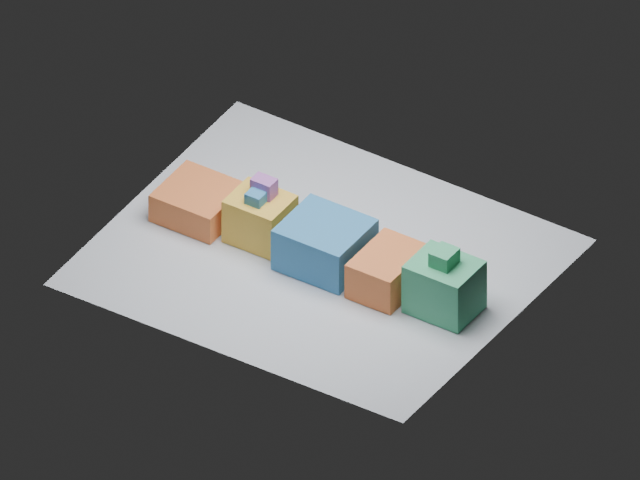
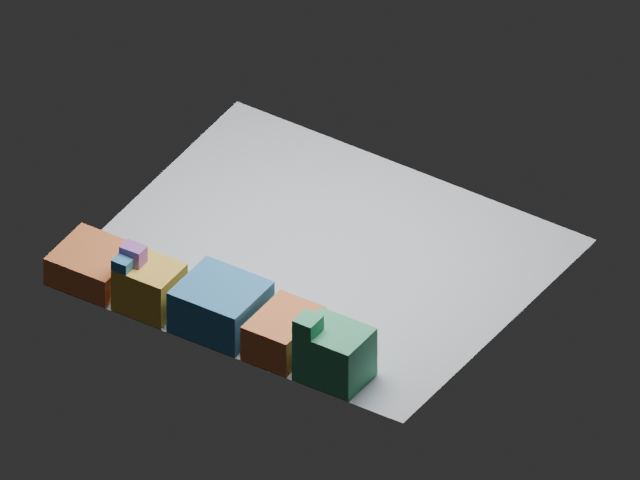

# 2026-10-23：HyperAgents 与 DREAM 的 3D 机制试验

**三组均已完成。起始搜索 E0 已在开发集和保留测试集达到满分，后续没有可测量的质量增益。** Hyper 自修改组确实执行了上一轮产生的新 MetaAgent，但相对固定 meta 组没有质量或调用次数优势，token 用量更高。本次结果支持执行机制成立，不能证明“自改进能力”提升。

可复查的 [report.json](../examples/comparison-20261023/report.json)、[冻结协议](../examples/comparison-20261023/protocol.json)、求解器、实际执行的 task/meta 源码、DREAM 策略和渲染结果均已发布。原始工作目录为 `workspace/comparison-20261023`；发布副本移除了本机路径、原始会话日志和命令。

## 固定条件与实现范围

- 移植初始提交：`ec822882f5a5573ac834d0aa461e7d6cc720fa56`；零调用契约修正：`c9d2260`。
- HyperAgents 上游：`59a68f672dfb92c74aeb7e61535d776fb36e172d`；DREAM fork：`361706351ccfabfca9b1829c9ce44177923271f5`。
- 统一请求配置：`gpt-6-astra`、medium reasoning、单次模型会话 timeout 300 秒，Codex CLI `0.163.0-alpha.11`。这些是请求配置和客户端版本，不是服务端模型身份认证。
- 两边使用逐字节相同的六个任务文件，**6 个开发场景、8 个保留测试场景**。对象尺寸和 ID 固定，求解器只返回 cuboid 中心位置；评价边界、接触支撑、碰撞和空间关系。测试集属于同一程序化任务族。
- 冻结任务、宿主、transport 和配置哈希；只用开发集选优，平分取后出现者。三组完成后才进行 held-out 评价。独立检查 14 份实际提示未发现保留测试场景或结果回流。
- **36 项离线测试通过**，检查接口、源码继承、预算、选用一致性、零调用和失败重试约束；不把测试通过视为学习效果。

| 组别 | 可变对象 | 本次实现 |
|---|---|---|
| Hyper adaptive | TaskAgent 与 MetaAgent 源码 | 两轮线性继承，合法子版本进入下一轮 |
| Hyper fixed-meta | TaskAgent 源码 | 同样两轮，始终保留初始 MetaAgent |
| DREAM | 探索调度策略 | 冻结历史重放选择，再用于新的在线生成 |

三个组共享一次新鲜 E0。本实现保留原始 task/meta 类的可执行接口，通过受限 shim 和结构化输出桥接；没有原生 Docker、自由工具编辑或完整 DGM archive/父代选择。因此，这是**受限的可移植机制试验，不是完整 DGM-H 复现**。两种框架的可变对象和提示接口不同，组间差异不能单独归因于递归程度。

## 实际结果

| 候选范围 | 开发平均分 | Held-out 平均分 | 严格成功率，开发 / 测试 | 实际模型会话 |
|---|---:|---:|---:|---:|
| 初始启发式 | 0.673845 | 0.683051 | 0% / 0% | 0 |
| 共享 E0 最佳 | 1.000000 | 1.000000 | 100% / 100% | 4，共享成本 |
| Hyper adaptive，第二轮累计最佳 | 1.000000 | 1.000000 | 100% / 100% | 2，E0 后新增 |
| Hyper fixed-meta，第二轮累计最佳 | 1.000000 | 1.000000 | 100% / 100% | 2，E0 后新增 |
| DREAM，第二轮累计最佳 | 1.000000 | 1.000000 | 100% / 100% | 6，E0 后新增 |

四个 E0 候选的开发分均为 1；三组两轮的在线最佳、累计最佳在开发和测试集也均为 1。严格成功要求全部约束成立，不能与平均软评分混同。

两个 Hyper 组各执行四次 TaskAgent，但这八次均**直接复用 E0 最佳求解器，未调用模型**。每组两次实际模型会话均用于 meta 更新。DREAM 使用两次策略更新和四次新求解器生成。预算上限为 22 次，实际使用 **14 次**；没有为了填满预算强制进行无用调用，也没有重复任何已付费调用。这不是等 token 或等计算量比较。

### 成本账本

| 分组 | Input tokens | Output tokens | Cached input | Reasoning output |
|---|---:|---:|---:|---:|
| 共享 E0 | 125,092 | 15,699 | 13,312 | 2,156 |
| Hyper adaptive | 134,115 | 10,283 | 0 | 737 |
| Hyper fixed-meta | 108,926 | 7,288 | 0 | 438 |
| DREAM | 390,885 | 28,560 | 0 | 2,565 |
| 合计 | **759,018** | **61,830** | **13,312** | **5,896** |

保留 CLI 原始用量分类；cached input 和 reasoning output 是细分类，不再次加进 input/output 总数。14 次调用均有用量记录、退出码为 0、无超时。累计调用耗时约 1,720.84 秒，含 CLI 开销，不等于项目总工时。此表不含本轮工程开发、主聊天或审计 agent 的消耗。

自修改组比固定 meta 组多用 25,189 input 和 2,995 output tokens，质量及模型调用数相同。两个 Hyper 组节省在线生成调用都来自现成解复用，不能归功于 meta 自修改；正式比较应加入“直接复用 E0”基线。

## 是否真的执行了改进后的改进器

执行链核验通过：初始 M0 的规范化源码 SHA-256 为 `e9215559e7f1b8269c4a31e592bacb3ed5ae0ac27c33ce5c849826df13137bf6`。自修改组第一轮产生 M1：`64b3b53cbea6174401f15ea815d3e8dc84367297ecacf90df7c46e4f6610cde3`；第二轮实际加载执行的正是这个版本。M1 修改了反馈组织、已有解复用判断和更新提示，产生的请求也实际发生变化。固定 meta 组两轮均执行 M0。

这证明修改进入了下一轮控制流程，并非只把代码存下来。**它仍不证明 M1 比 M0 更善于改进求解器。** 任务已在 E0 饱和，两个版本都复用了同一个求解器。第二轮生成了 M2，但没有第三轮更新，不能声称已验证 M2 的后续作用。

### DREAM 的重放收益如何解释

L0 重放中，初始策略 reward 为 −0.05，P1 为 0.45；提升来自部分较低 beta 下的预算选择，质量已满分。默认 beta=0.6 的策略并未因此自行将调用从 4 减到 2；本次在线每轮两次调用来自宿主预设上限。

L1 加入 E1 部分轨迹后，P1 与 P2 的 reward 均为 0.20，P2 因官方平分取后规则被选中。两个阶段的轨迹池不同，0.45→0.20 不能解释为策略退化。两轮都已核验 selected→promoted→used→archive 的源码哈希一致；没有以尚未执行的候选或未来结果替代在线成绩。

## 一次公开记录的工程修正

初始模型可见契约允许 TaskAgent 最多调用模型一次，但宿主错误地要求恰好一次。第一个 adaptive TaskAgent 返回已有解且不调用模型，触发了宿主错误；这个阶段在任何模型调用前就结束。

随后修正宿主以接受合法零调用任务，并加上测试。**模型可见 API 提示保持原字节不变，已完成的付费调用没有重跑。** 经独立验证该阶段没有执行请求或模型日志，才恢复这一次未付费阶段。一般的失败或状态不明阶段仍拒绝自动重试。

原始协议、失败 journal、worker 验证保留在 [diagnostics](../examples/comparison-20261023/diagnostics/)，修改时间和宿主哈希记录在 [amendments.json](../examples/comparison-20261023/amendments.json)。因此本次应称为透明记录修正的工程试验，不能冒充全程无改动的预注册效果研究。

## Blender 输出验证

用 Blender 4.5.11 LTS 对 E0 最佳和 DREAM 最终最佳在同一个 `dev_00` 场景、相同相机及材质下导出并检查。两份 GLB 各 8 个对象，重新导入后的世界坐标包围盒检查均为 **8/8 通过**；两张 PNG 也已人工式视觉检查。E0 求解器与两 Hyper 组实际返回的求解器规范化源码完全一致。

| E0，也对应两个 Hyper 组 | DREAM 最终最佳 |
|---|---|
|  |  |

渲染目录保留候选来源、源码哈希、GLB 和 reimport 检查。这个检查只证明该场景的导出一致性，不代表全部场景已渲染，也不证明任意 3D 资产生成、外观或语义质量。

## 下一步能检验什么

目前不能判断哪个框架具有更好的自改进能力。更有区分力的研究应提前冻结更难的新任务族，并进行 task/meta 的 **2×2 交换**：`(M0,T0)`、`(M1,T0)`、`(M0,T1)`、`(M1,T1)`。冻结改进器后从相同合法起点测量固定预算内的 Improvement@k、质量曲线及成功率，多次独立重复，并计入产生 M1 的成本。

更难的任务可加入更深支撑层级、拥挤布局、非轴对齐几何及局部编辑保持约束；不要看到本次结果后修改本次评分。加入直接复用 E0 的基线，并在完整 DGM-H 对比前恢复 archive 和父代选择机制。

详见 [论文审计](PAPER_AUDIT_ZH.md)、[代码与迁移审计](CODE_AUDIT_ZH.md)、[执行结果独立审计](RESULTS_AUDIT_ZH.md)、[DREAM 对照审计](DREAM_COMPARISON_AUDIT_ZH.md) 和 [运行方法](PORTABLE_3D.md)。
